# Практична робота 8 — Робота з асинхронним кодом в Dart

**Варіант 1: Моніторинг розумної теплиці**
Виконав: Терещенко Микола Анатолійович, група аІк-43

## Опис

Панель теплиці з чотирма датчиками (дві температури, вологість, освітленість).
Під час відкриття екрана паралельно завантажуються список датчиків, порогові
значення та підсумок за добу — з одним спільним індикатором. Далі показання
оновлюються кожні 1–2 с. Вихід за поріг підсвічує картку червоним і показує
SnackBar (не частіше ніж раз на 10 с для одного датчика). Кнопка
«Пауза / Продовжити» зупиняє таймери датчиків. Збій одного датчика видно лише
на його картці, решта працює далі.

Мережа імітується класом `FakeApi` (`Future.delayed` + частота збоїв).
На головному екрані можна змінити частоту збоїв, увімкнути «повільну мережу»
(тайм-аут), «порожню теплицю» та часті збої датчиків — без зміни коду.

## Запуск

```bash
flutter pub get
flutter run            # або flutter run -d chrome / -d windows
flutter analyze
flutter test
```

## Де що в коді

| Вимога | Файл / місце |
|---|---|
| `Future.wait` + тайм-аут 3 с | `lib/services/greenhouse_service.dart` → `loadDashboard()` |
| Імітація мережі, частота збоїв | `lib/services/fake_api.dart` |
| `StreamController.broadcast`, таймер, пауза, `addError` | `lib/services/sensor_feed.dart` |
| `FutureBuilder` (Future створюється в `initState` / `_retry`) | `lib/screens/dashboard_screen.dart` |
| `StreamBuilder` у кожній картці | `lib/widgets/sensor_card.dart` |
| Стани завантаження / помилки / порожньо | `lib/widgets/state_views.dart` |
| Перевірка `mounted` після `await` | `dashboard_screen.dart` → `_load()`, `_checkThreshold()` |
| `dispose()`: скасування підписок, зупинка таймерів, закриття контролерів | `dashboard_screen.dart` → `dispose()` / `_stopFeeds()`; `sensor_feed.dart` → `dispose()` |
| Обмеження SnackBar раз на 10 с | `dashboard_screen.dart` → `_checkThreshold()` |

## Скриншоти станів (`docs/`)

| Стан | Файл |
|---|---|
| Головний екран | 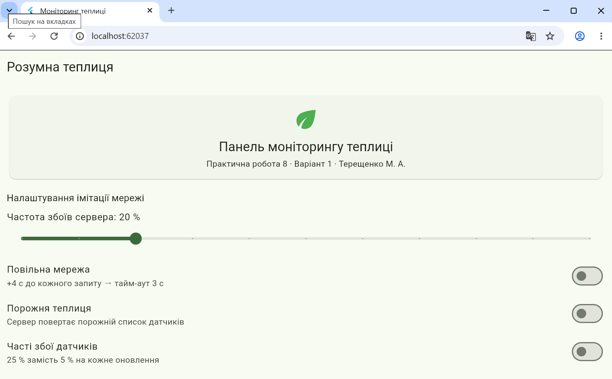 |
| Завантаження | 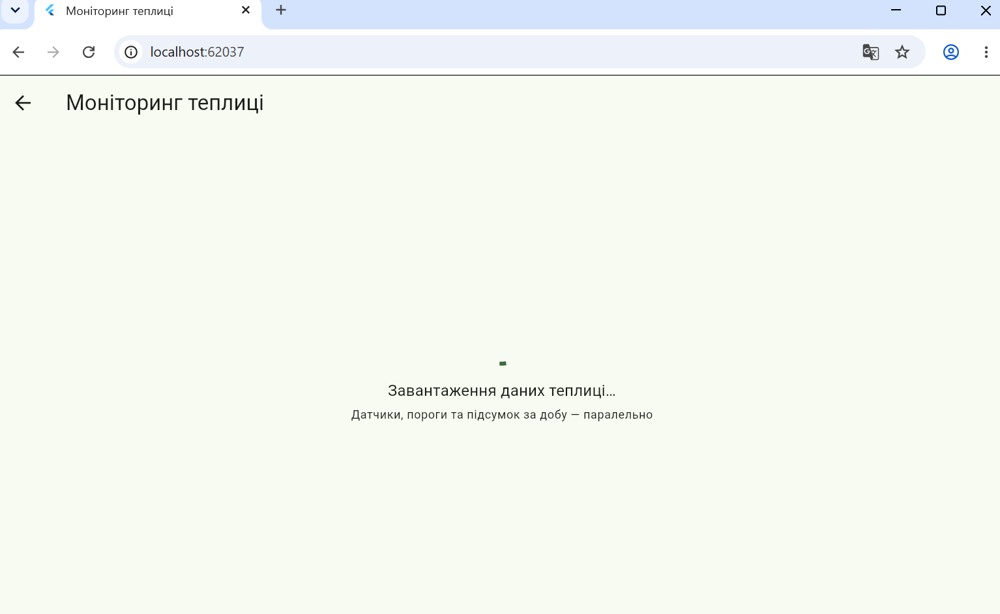 |
| Дані | 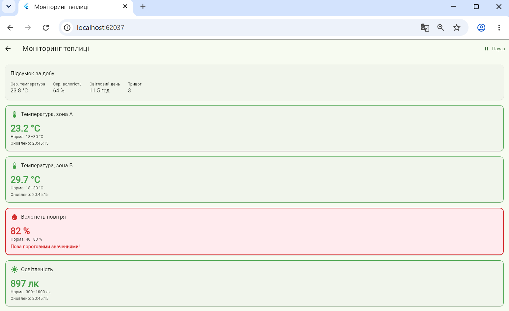 |
| Оновлення в реальному часі |  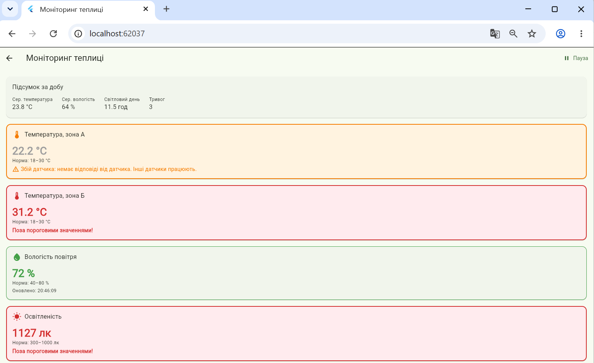 |
| Спрацювання порога + SnackBar | 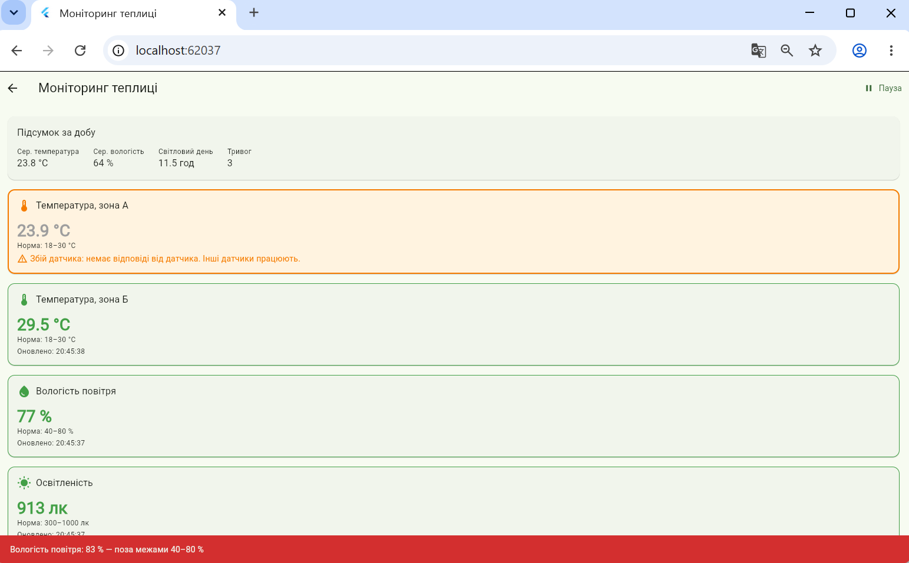 |
| Збій одного датчика | 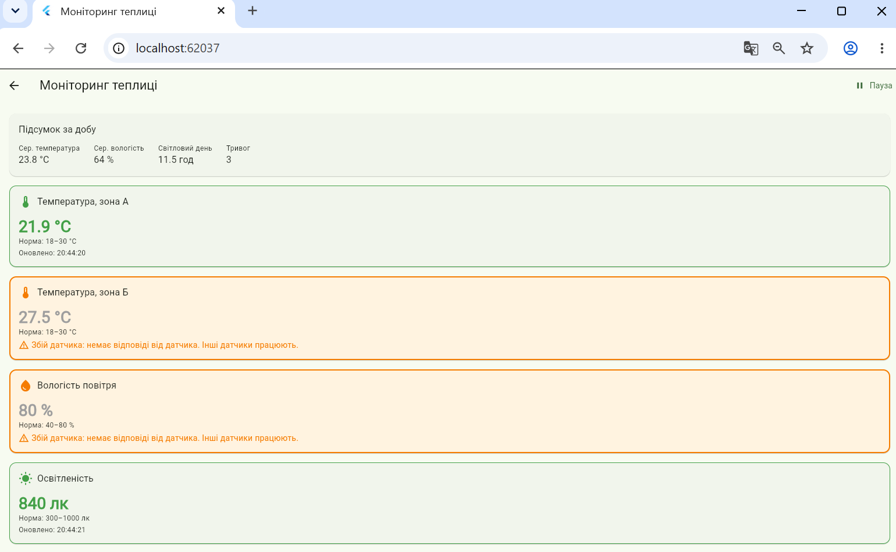 |
| Пауза | 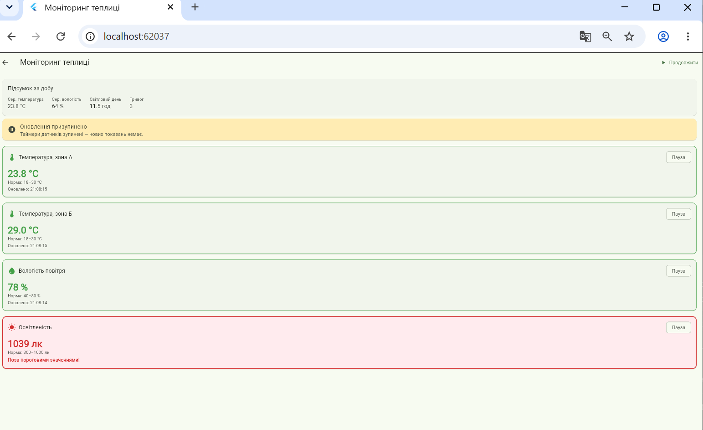 |
| Помилка з кнопкою «Повторити» | 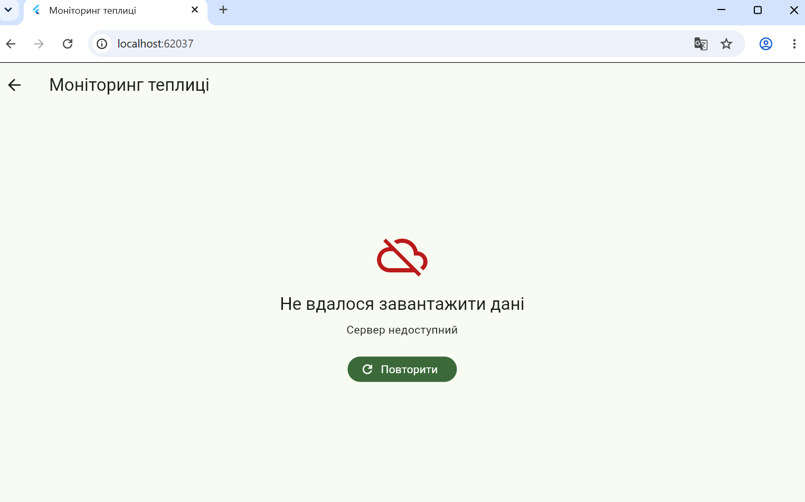 |
| Тайм-аут | 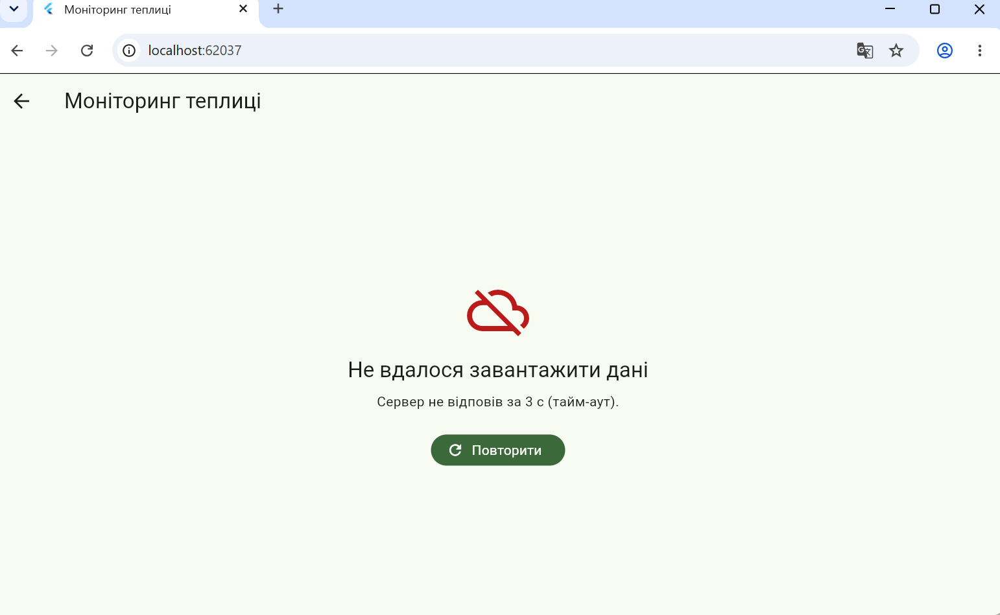 |
| Порожньо | 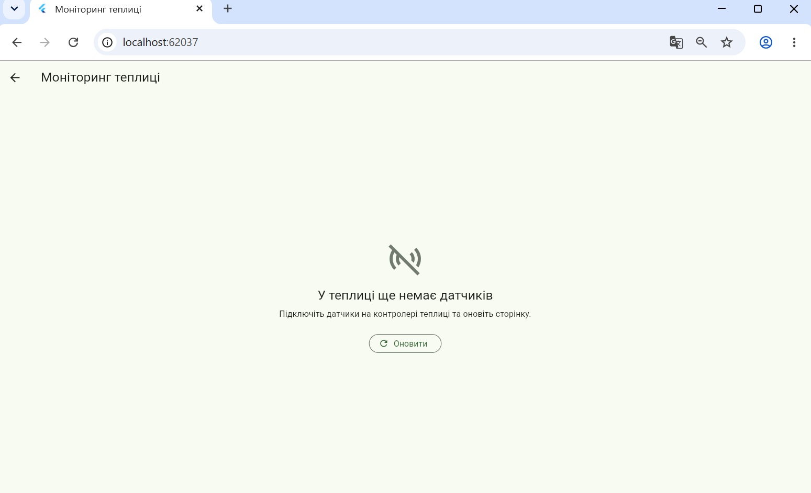 |
| Вихід з екрана — консоль без помилок | 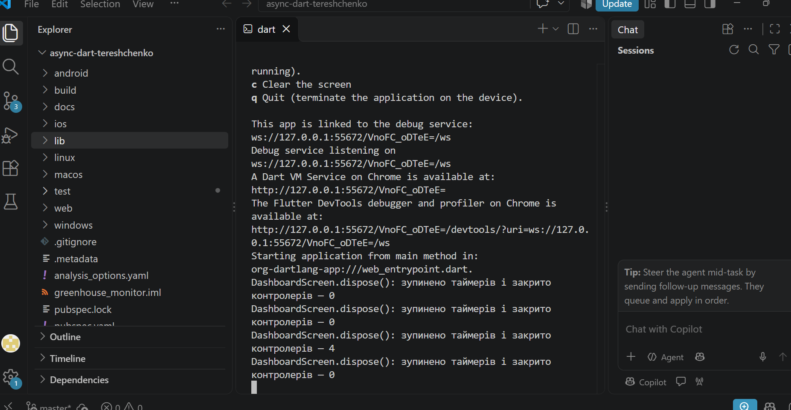 |
| `flutter analyze` | 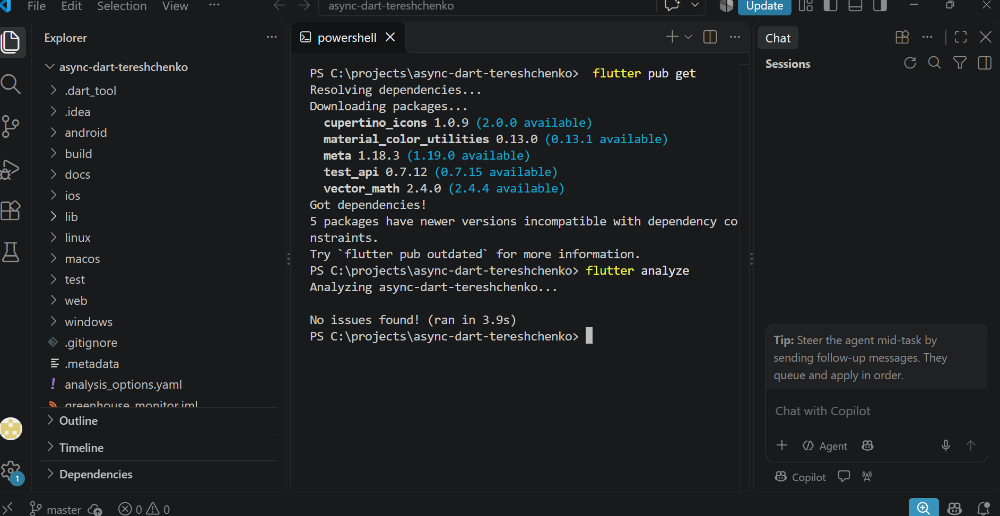 |
| `flutter test` | 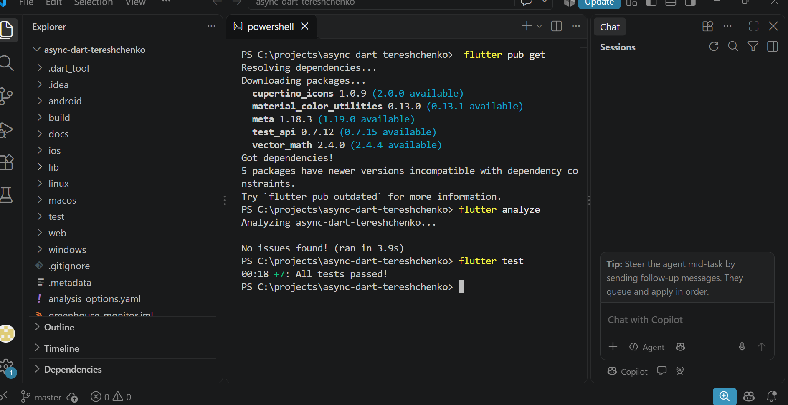 |

## Декларація використання ШІ

- **Інструмент:** Claude (Anthropic).
- **Мета:** допомога зі структурою проєкту, кодом сервісу-імітації, потоків датчиків і екрана, текстом README.
- **Запит:** «Виконай практичну роботу 8 (асинхронний код у Dart), варіант 1 — моніторинг розумної теплиці, і розпиши покроково скріни».
- **Що увійшло до роботи:** каркас файлів `lib/` і `test/`, цей README.
самостійно створив проект і запустив застосунок у Chrome,перевірив усі стани (завантаження, тайм-аут, помилка, дані, поріг, пауза, порожньо), знайшов і виправив помилку з картками під час паузи (додав ValueKey), перевірив flutter analyze і flutter test, зробив скриншоти.
